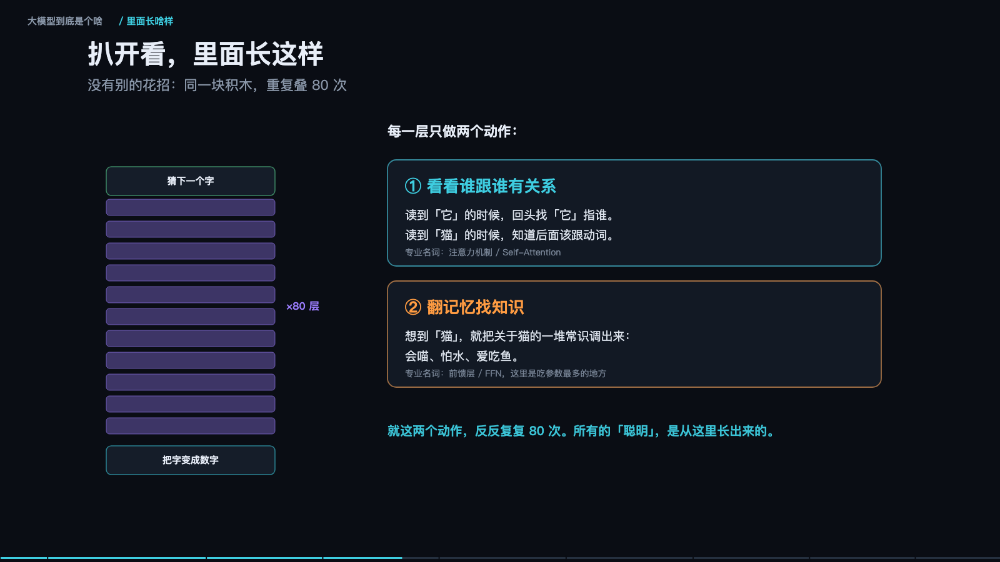

> **大模型入门系列** · 共 14 集 · 本集为第 1 集
> 下一集：[二、往深一层](/AI/llm101-02.html) ｜ [系列总览](/AI/7b3f9a21.html)

## 这套系列讲什么

这套东西原本是十几集独立的动画，一集只回答一个问题：它是什么、里面怎么转、指令链怎么拼、工程上怎么不出事、怎么变成能上线的东西。单独看每一集都成立，但连起来看才有一条完整的线——从「猜下一个字」这个动作出发，一路走到「接进业务流程」这件事上。

所以这里把它整理成一套 14 集的系列。每一节前面挂一张配图和一段可交互动画，动画按章节推进，可以暂停、可以按左右方向键跳章，也可以点进度条直接落到某一节；下面正文是同一份内容的文字版，细节比动画里的屏内文字更多一些。读的顺序建议就按排列顺序来，因为后面的很多结论是前面几节推出来的——比如第六集的成本结构，前提是第三集讲的「消息拼接」；第四集的上下文预算，前提是第二集讲的工作台容量。

全篇只讲一件事的两面：模型本身的能力边界在哪里，以及围绕它叠出来的工程系统怎么做才不至于翻车。这两件事经常被混在一起谈，混在一起谈的结果就是：模型换了一版，产品还是一样难用；提示词改了几十遍，效果还是不稳。这篇文章试图把这条界线划清楚——哪些是模型天生做不到的，哪些是你在外面少做了一步。

动画里的语气偏口语，正文里的表述会紧一些。两者内容一致，不冲突。

<!--more-->

## 系列目录

1. [一、大模型到底是个啥](/AI/llm101-01.html) ← 本集
2. [二、往深一层](/AI/llm101-02.html)
3. [三、Prompt、Thinking、Function Calling](/AI/llm101-03.html)
4. [四、上下文工程与 Agent 可靠性](/AI/llm101-04.html)
5. [五、微调](/AI/llm101-05.html)
6. [六、Token 与账单](/AI/llm101-06.html)
7. [七、量化与端侧推理](/AI/llm101-07.html)
8. [八、多模态](/AI/llm101-08.html)
9. [九、检索](/AI/llm101-09.html)
10. [十、把话说明白](/AI/llm101-10.html)
11. [十一、上线前的那些坑](/AI/llm101-11.html)
12. [十二、记忆](/AI/llm101-12.html)
13. [十三、从能跑到好用](/AI/llm101-13.html)
14. [十四、从提示词到像素](/AI/llm101-14.html)

---

<iframe src="/slide/llm-explained.html" style="width:100%;height:520px;border:0;border-radius:8px" loading="lazy" allowfullscreen></iframe>

如果只允许用一句话解释大模型，最准确的说法不是「会思考的机器」，而是「一个把接下一个字练到极致的高手」。你给它半句话，它算出下一个字最可能是什么，填进去，再把新的半句话交还给自己，继续算。写文章、做翻译、回答提问、补全代码，全部是这同一个动作在不同输入上的重复。它并不存在一个「理解问题然后作答」的额外阶段。

这里的「字」不是汉字，是 token。一个汉字通常算一到两个 token，英文长词会被切成几块，比如 unbelievable 会变成 un / believ / able 三段。所以业内说「下一个 token 预测」，说的就是这件事，不是什么更高深的机制。

举个具体的例子。输入是「一只猫坐在」，它不会先去想象一只猫，而是给所有候选字打分：窗、地、沙、桌、椅，分数高的被选中，填进空格。它不是「懂」猫，而是读过的语料里「猫坐在窗台」「猫坐在地上」这类句子出现得足够多，于是这些接法在它的参数里被反复加强。猜得准不准，取决于它读得多不多、见得多不多。这句话听起来像废话，但它是整套技术的全部前提。

常被问的第二个问题是「它凭什么厉害」。答案同样朴素：三个「大」同时加上去——脑子大、书读得多、练得久。脑子大指的是参数特别多，几十亿到上万亿个；每被纠正一次，就有大量参数被微调一下。书读得多指的是训练语料几乎覆盖了整个互联网的文字。练得久值得拿几万张显卡连着跑几个月，电费是天文数字。三样缺一不可，就像养学生：只聪明不读书不行，只读书不练也不行。而三者同时放大的时候，能力增长呈现出可预测的斜率——这就是 Scaling Law，规模翻倍，错误率按固定斜率往下掉。这条规律是整个行业敢于投入巨额算力的唯一理由。

再往里扒一层，结构上没有任何花招：同一块积木重复叠八十次。所谓积木，就是一层里只做两个动作。第一个动作是「看看谁跟谁有关系」——读到「它」的时候回头找「它」指谁，读到「猫」的时候知道后面该跟动词，学名叫注意力机制（Self-Attention）。第二个动作是「翻记忆找知识」——想到「猫」就把关于猫的一堆常识调出来：会喵、怕水、爱吃鱼，学名叫前馈层（FFN），这里也是吃参数最多的地方。就这两个动作反反复复八十次，所有的「聪明」都是从这里长出来的。

它被教出来的过程分三堂课，顺序不能乱。第一课是海量读书，读的时候一直在做练习：遮住下一个字自己猜，猜错就拧一下旋钮，重复几万亿次；学的是怎么说话、世界上都有什么，这一课叫预训练（Pretraining）。第二课是老师示范，人写几万条问答让它照抄；它原本只会接着往下写，不会「回答问题」，看了几万条示范才学会你问我答，这一课叫监督微调（SFT）。第三课是按喜好打分，同一个问题让它答十个版本，人来排序哪个更好，它就朝着人更喜欢的方向调整，这一课叫人类反馈强化学习（RLHF）。

### 一次回答的两段速度

它回你话的时候分两步，快慢完全不一样。第一步是把你说的话整段读一遍，很快——所有字一起处理，一次算完；这一步在工程上叫 prefill。第二步是一个字一个字往外蹦，很慢——每蹦一个字，都要把整个脑子从头过一遍；这一步叫 decode。所以你看到字一个一个「打」出来，不是特效，是真的在一个一个算。

中间它会把刚说过的每个字记在一张草稿上，省得反复重算，这张草稿就是 KV cache。但草稿只在这一次请求里有效，聊完就扔，不会带进下一段对话。这也解释了长对话为什么慢：草稿越来越长，每蹦一个字要翻的家当越来越多。慢的原因不是算不动，是「翻得慢」。

### 为什么它会一本正经地胡说

因为它要的是「顺口」，不是「正确」。接得顺嘴就吐出来，不管真假，所以会一本正经地胡说八道。这是出身决定的，不是坏了：它的训练目标函数只奖励「像人写的下一句」，从不奖励「符合事实」。此外它的记性只有这一段对话，聊完就忘；它什么都懂一点、什么都不精，常识很行，专业细节容易翻车，尤其是很窄、很少见的领域；它只会说，不会做——不能上网、不能查库、不能点按钮，要动手得别人给它装手脚。

### 三个衍生概念，别搞混

经常被混在一起的几个名字，其实分工很清楚。小模型是专门训练出来干一件事的程序，比如只认人脸，大模型则是一个顶一堆。知识库是一堆资料、能按关键词查出来，大模型记不住细节，得靠它现查，这个组合叫 RAG。Agent 是给大模型装上的手脚，让它能真去点按钮、发邮件、调接口。至于画图模型，那是另一个流派：靠擦噪点作画，一个猜字、一个擦噪点，两回事。

记住这个比喻就够了：大模型是「嘴」，其余都是给它配的「眼睛、手和笔记本」。

> **原来如此**：大模型就是一个读过全世界文字、把「猜下一个字」练到极致的高手。它很会说话——但它并不知道自己在说什么。

怎么判断一个东西是不是大模型，三个特征：参数规模几十亿以上；什么都能干，不是只会一件事；靠接龙（或擦噪点）出结果。三条都符合，才是同一类东西。

---

> 下一集：[二、往深一层](/AI/llm101-02.html) ｜ [系列总览](/AI/7b3f9a21.html)
