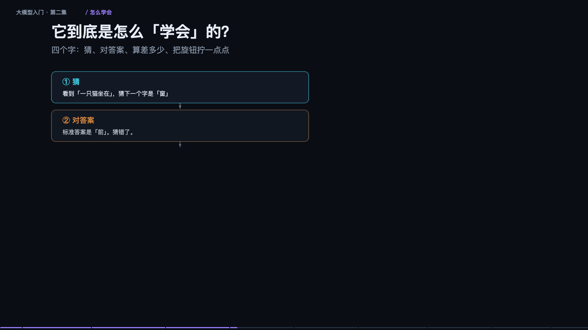

> **大模型入门系列** · 共 14 集 · 本集为第 2 集
> 上一集：[一、大模型到底是个啥](/AI/llm101-01.html) ｜ 下一集：[三、Prompt、Thinking、Function Calling](/AI/llm101-03.html) ｜ [系列总览](/AI/7b3f9a21.html)

<iframe src="/slide/llm-advanced.html" style="width:100%;height:520px;border:0;border-radius:8px" loading="lazy" allowfullscreen></iframe>

第一集讲的是「它是什么」，这一节讲「它内部怎么转，以及怎么用」。要拆的部分有六块：字怎么变成数字、注意力怎么算、八十层为什么不会崩、它到底怎么学会的、出结果时你能拧哪个旋钮、记不住和不会动手分别怎么办。

第一步是把字变成一串数字，机器不认识汉字，只认识数字，中间有两次转换。以「今天天气不错，适合出门」为例：先切成小块（token），再把每个小块变成一整排数字，也就是向量，几百到几千个数。这些数字组成坐标，意思越近坐标越近——「猫」的坐标天然挨着「狗」，离「汽车」很远。这是后面一切语义能力的基础，也是后面所有翻车（比如编号认不出来）的根源。

还要再加一层「位置」。不加位置的话，「猫吃鱼」和「鱼吃猫」在它眼里完全一样，因为集合没变。位置编码的作用就是让顺序成为信息的一部分。这一步很便宜，但去掉它模型立刻废掉。

第二步是注意力，也就是它怎么「读上下文」。机制不复杂：每个词都发出一个提问（Q）——「你们谁跟我有关系」；同时每个词亮出一张名片（K）——「我是啥」；配对成功之后，把内容（V）交出去。问、对、取，三个动作。真正的信息在 V 里，Q 和 K 只负责决定「取谁的」。

而且不是只开一组，是同时开很多组，八到一百二十八个小组一起看。有的组管语法，有的组管指代，有的组管「谁修饰谁」。最后把各组的结论拼起来，理解就立体了。这叫多头注意力。

还有一个强约束：不许偷看后面。生成的时候只能看已经出现的词，后面的必须遮住。不遮住就等于考试时偷看答案，模型学不会任何东西——它只要抄下一个词就行了，永远不需要真正预测。这个遮罩叫因果掩码（Causal Mask），是大模型能一个字一个字往下写的制度基础。

### 凭什么能叠八十层还不崩

关键在一个很小的设计：每层只「补一点」，不推翻重来。具体做法是每层算完之后，把输入原样抄一份加回去，学名叫残差连接。如果不做这个加法、直接覆盖，层数一多数值就乱，直接爆掉；加上这一份「原样抄一份」，八十层也稳。

打个比方，像传话游戏：每个人只负责补充一两个细节，不重新讲一遍，传一百个人故事还在。另外还有一个配套动作：每算完一次，把数值拉回固定范围，也就是归一化。不然数字越乘越大，机器直接算炸。这两个设计看起来是工程细节，实际上是深层模型能训练起来的前提。

### 它到底是怎么「学会」的

四个字可以概括：猜、对答案、算差多少、把旋钮拧一点点。看到「一只猫坐在」，猜下一个字是「窗」；标准答案是「前」，猜错了；差距就是损失（loss），差得越多罚得越重；然后反推是哪些旋钮导致了这次猜错，每个拧一丁点。重复几万亿次，就这么朴素。

值得强调的是最后半句：每一个旋钮都只被拧了极小的一下。「学习」的全部含义，就是这几万亿次微调。它从没被教过「什么是对的」，它只在学「怎么接得更像人类写的」。这两件事不一样，这是理解它所有缺陷的出发点。

### 出结果时你能拧的那个旋钮：温度

模型给出的不是一个字，是每个字的概率。温度决定你多大胆地使用这些概率。温度调低，概率分布变成一根高高的尖峰，几乎每次选同一个，稳定但死板，像考试只选最有把握的答案。温度调高，分布变成一堆矮胖柱子，敢选冷门词，写法有变化，但也会把「跑掉」这种词选出来。中间档最常用。

还有一个配套的 top-p：只从累计占九成的那些词里选，长尾直接砍掉，防止胡说。温度和 top-p 都不改变模型的判断，只改变你怎么从它的判断里采样。这一点很重要——很多人以为调温度能让模型变聪明，实际上它只让输出变稳或变野。

### 记不住资料，和不会动手，是两件事

它记不住你们公司的资料，解法不是「再教它一遍」，而是每次提问时把资料翻出来给它看。原因是它的工作台（上下文窗口）就这么大：你说的话、它的回答、给的资料、对话历史，全挤在同一块地方，塞满了前面的就得扔掉。所以长对话它会「忘了开头」，这不是它在偷懒，是物理容量。

做法是让它先去翻书：把你的文档切块、算相似度、取最像的三块、塞进工作台，和问题一起交给模型，它照着资料回答，就有了依据。这就是 RAG。这里有两个高频的坑：一是切块切坏了，一句话被切成两半，检索到半句，答案就跑偏；二是资料太长会「中间塌陷」，塞进去十万字，它往往只看开头和结尾，中间那段被忽略。所以给资料要短、要分段、要点明「请根据以下内容回答」——这不是玄学，是在帮它分配注意力。

从「只会说」到「会动手」靠的是 Agent：给它装工具。它想、调工具、看结果、再想，一直转，直到它认为任务完成。注意它输出的不是「帮我搜一下」这种自然语言，而是一段结构化指令，真正执行的是你的程序。Agent 比聊天更容易翻车，因为一步偏、后面全偏，错误会累积还越走越远。所以实用的 Agent 都这么设计：关键动作要人确认、每步留痕可回滚、拆小任务别一次做完。

> **原来如此**：聊天是给建议，Agent 是动手办。动手就要担责，设计必须更保守。

### 端侧、中杯、旗舰：怎么选

按规模粗分三档。端侧小模型十亿到八十亿参数，跑在手机和笔记本上，快、免费、离线、隐私好，但复杂推理不行。中杯通用两百亿到七百亿参数，公司一台服务器能跑，能力够用且数据不出内网，贵一点、部署要点功夫。旗舰闭源上千亿，只给接口，云端调用，推理和长文能力最强，但最贵、数据要出内网。

怎么选的原则只有一句：能力不是越高越好，是「刚好够用」最划算。大多数公司的默认选择是中杯。至于怎么评，别信排行榜——拿你自己二十条真实问题做一套小测跑一遍，这份小测比任何榜单都准。顺带一提，模型输出不稳定，同一个问题问十次答案都可能不同，你需要的是「十次里有几次能用」，不是「某一次很惊艳」。成本也要按公式算：单价乘用量乘重试次数，真实账单常常比预估高好几倍，因为没人一开始就想到要重试。

两节看下来其实就几句话：字变数字，数字在注意力里互相交换信息，一层层微调往上叠；猜错就拧旋钮，拧几万亿次，它学会了像人一样接话；记不住就查资料，不会做就装工具，拿不准就调温度。

> **原来如此**：它是个极好的助手，但不是权威。它给出的每个字都「很像」，不等于「正确」。重要的事，永远自己核一遍。

---

> 上一集：[一、大模型到底是个啥](/AI/llm101-01.html) ｜ 下一集：[三、Prompt、Thinking、Function Calling](/AI/llm101-03.html) ｜ [系列总览](/AI/7b3f9a21.html)
