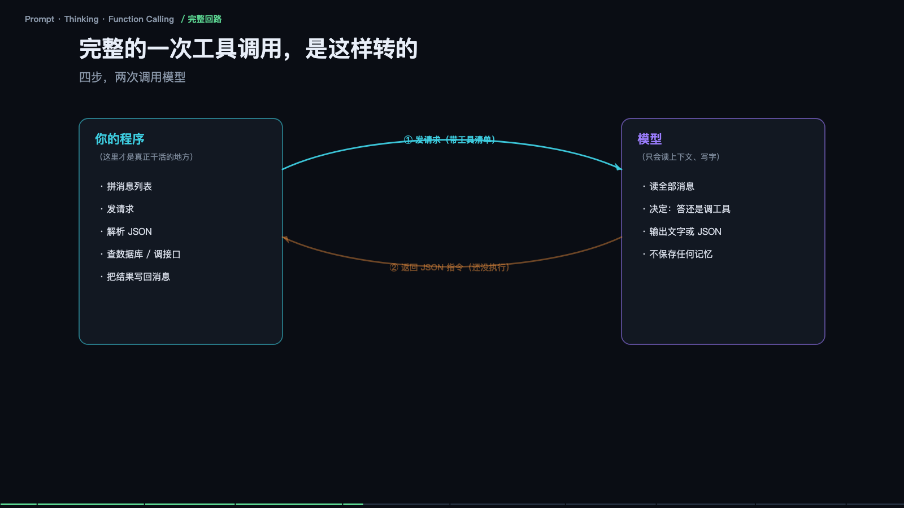

> **大模型入门系列** · 共 14 集 · 本集为第 3 集
> 上一集：[二、往深一层](/AI/llm101-02.html) ｜ 下一集：[四、上下文工程与 Agent 可靠性](/AI/llm101-04.html) ｜ [系列总览](/AI/7b3f9a21.html)

<iframe src="/slide/llm-agent-core.html" style="width:100%;height:520px;border:0;border-radius:8px" loading="lazy" allowfullscreen></iframe>

把一次请求拆开，会看到三件互不相同的事：你给它看什么（Prompt）、它想几步再答（Thinking）、它能动手做什么（Function Calling）。这三件事常被当成三个技巧分别讨论，实际上它们是一条链上的三段，而且拼的是同一个东西——上下文里到底有什么。

先说 Prompt。它不是咒语，作用是「把它的注意力拨过去」。你写的每个词，都会变成它在上下文里重点盯住的地方。你写「你是资深法务，请逐条核对合同里的风险点，只输出一张表格，不要解释」，模型内部的注意力就被拨动了三处：「资深法务」调用法律知识，「逐条核对」促使它一条条展开，「只输出表格」把输出概率往表格这个形状上推。

这三处其实对应三类句子，值得分开记。身份句换脑子，告诉它这件事该调用哪一块知识——同一句话，法务身份和程序员身份，答案完全不同。动作句换做法，说的是「做什么类型的活」：核对、总结、翻译、挑错，要用动词，不要用形容词。格式句卡形状，把输出概率往某个形状上推：表格、JSON、不超过一百字，这一句最省钱也最有效，因为它同时压缩了输出长度和歧义空间。

换个说法更容易理解：Prompt 不是在对模型下命令，模型也不会「服从」，它只是改了你给它的上下文，于是它接下去写的字就变了。所谓提示词工程，本质是设计上下文，让它的注意力落在你要的地方。

### 你发的三条消息，其实会被拼成一整段文字

界面上看到的是 system、user、assistant 三种角色分开的消息，但到了模型那里，它们会被拼成一整段连续的文本，用特殊标记分隔：`<system> <user> <assistant>`，靠这些标记区分「谁说的」。这个事实解释了三件事。

第一，模型是无状态的：它不记得上一次聊天，所以每次都得把全部历史重新发一遍。每一次请求，这一整条都要重新算一遍——这就是为什么聊得越久越慢、越贵。第二，顺序就是权重：放在最后的指令，通常比开头的更被重视。第三，越长越贵：输入按 token 计费，历史越长，每轮都更贵。实用结论很直接：长对话要主动总结压缩，别指望它记得住几十轮之前的细节。

### Function Calling：它其实一次都没执行过代码

这是被误解最深的一处。模型唯一会做的事是「写字」。所谓调工具，是它把「要调什么」写出来了，仅此而已。

流程是这样：你先给一份「说明书」，写明工具名、作用、参数，随请求一起发过去；它读完之后输出一段结构化文字，比如要查天气的城市名，包在一个约定的 JSON 结构里。到这一步为止，模型什么都没执行，它只是生成了一串长得像指令的字符。真正去查天气的，是你写在程序里的代码——执行的永远是你，不是它。

由此推出三条实践纪律。说明书就是 prompt，写得含糊它就挑错工具，这是最常见的故障来源。参数容易编，你没给范围，它可能编一个不存在的城市，所以枚举、格式、例子都要写死。工具别给太多，一次给三十个工具，选错的概率直线上升，按场景分组，每次五到八个。

### 一次完整的工具调用怎么转

四步，两次调用模型。第一步，程序拼好消息列表、带上工具清单，发出请求。第二步，模型读全部消息，决定是直接答还是调工具，返回文字或 JSON 指令。第三步，程序执行——查数据库、调接口——把结果写回消息列表。第四步，模型读到结果，给出最终回答。

整个过程中模型被调用了两次：第一次决定做什么，第二次把结果组织成人话。中间那段真正干活的，全是你的代码。它也在这个过程中证明了自己不保存任何记忆：每一轮都是重新读一遍全部消息。

所以 Agent 的强弱，一半看模型，一半看你的工具写得好不好、结果喂得干不干净。这句话在后面的第四集和第六集会反复出现，因为工具结果的格式直接决定了成本和质量两件事。

### Thinking：为什么写出来就变准了

先看一道题：一个班三十人，六成会游泳，会游泳的人里三分之一会蛙泳，问会蛙泳的几个人。直接答，很多模型会说十五人——它跳过了中间步骤，在没算出十八的情况下直接给了结论，而正确答案是六。

如果让它先打草稿：三十乘六成等于十八，十八乘三分之一等于六，所以答案是六，它就对。差别不在「想得多有诚意」，而在它只能看见已经写出来的字。十八这个中间结果被写进上下文之后，后面每个字都能直接用它；不写出来，就等于让它一步跨完三级台阶，算错一步就再也补不回来。

所以思考的本质是：把中间过程写进上下文，给自己造出更多「可以踩的台阶」。这顺便解释了为什么思考要花 token、要变慢——台阶是字，字是钱。

### 三种制造台阶的做法

不是三种技术，是三种实现成本的取舍。

提示词式：加一句「请一步步思考」，最便宜，任何模型都能用，本质是命令它多写中间步骤，适合日常分析、算数、推理题。原生推理模型：训练时就学会了长思考，有独立的思考预算，会自动展开很长的推理再作答，思考 token 照样收费，适合难题、代码、数学。工具化思考：边想边做，用结果纠正思路，走的是 ReAct 式的循环——想一步、查一下、看结果、再想，成本是多次调用加往返延迟，适合需要外部事实的复杂任务。

别忽略账单：思考内容也算 token，还占上下文。让模型对「今天星期几」想两千字，纯属浪费。经验法则是——问题越需要多步推算，思考越值；越需要查事实，越该去做工具调用而不是硬想。

> **原来如此**：Prompt 决定它看得见什么，Thinking 决定它想几步，Function Calling 决定它能动手到什么程度。三者共同的上限，都是同一件事：上下文里到底有什么。

### 三个最常见的坑

第一，否定式指令反而更容易触发。写「不要编造、不要用术语」，结果它偏偏提到了。原因是那个词本身也进了上下文，也在占注意力。改成正向指令：只使用资料里的内容；用日常词。

第二，工具给太多，它就挑错。一次挂三十个工具，明明该查订单，它去查了物流。本质是分类问题：候选越多，选错概率越大。按场景分组，每次只给五到八个，描述里写清「什么时候该用」。

第三，简单问题也硬让它想。今天星期几这种事，想太多等于台阶造太多，走岔路的概率也变大。简单任务关掉长思考，难题才开，分级处理。

通用解药只有一条：把「不许做什么」改写成「应该做什么」。这也是为什么真正好用的 Agent 产品，看起来都很啰嗦——大量具体规则，而不是一段万能咒语。

---

> 上一集：[二、往深一层](/AI/llm101-02.html) ｜ 下一集：[四、上下文工程与 Agent 可靠性](/AI/llm101-04.html) ｜ [系列总览](/AI/7b3f9a21.html)
