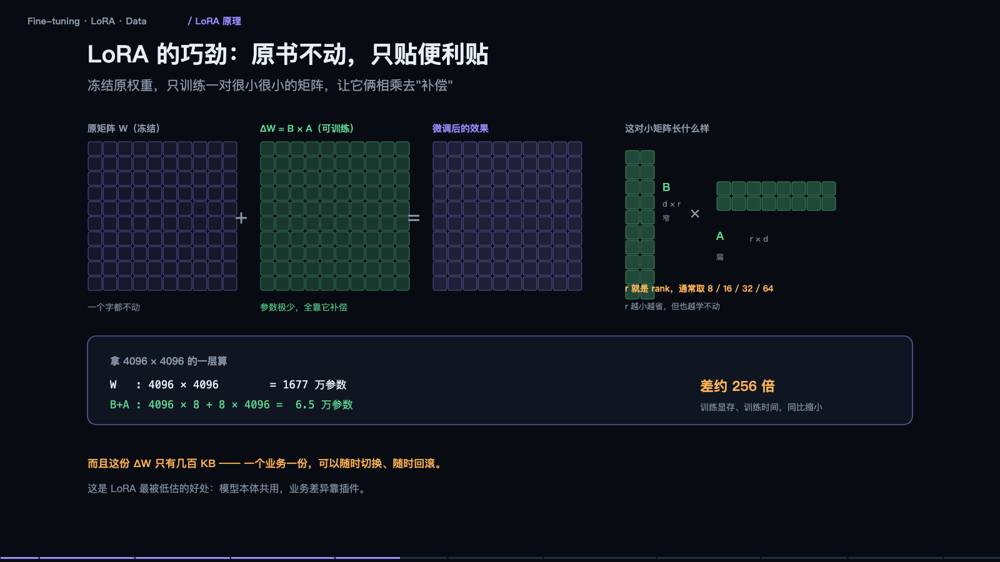

> **大模型入门系列** · 共 14 集 · 本集为第 5 集
> 上一集：[四、上下文工程与 Agent 可靠性](/AI/llm101-04.html) ｜ 下一集：[六、Token 与账单](/AI/llm101-06.html) ｜ [系列总览](/AI/7b3f9a21.html)

<iframe src="/slide/llm-finetune.html" style="width:100%;height:520px;border:0;border-radius:8px" loading="lazy" allowfullscreen></iframe>

微调是被误解最多的一块。在动手之前，必须先完成一次分诊：你缺的到底是知识、手艺，还是上下文长度。这三种缺口对应三种解法，用错一个，钱和时间都白花。

缺知识：它不知道你们公司的退货规则。解法是把文档检索出来塞进上下文——知识天天变，改一行文档就生效，不需要重新训练。缺手艺：它答得像客服机器人，不像你们的药师。这种要用微调，让它学会一种固定的说法和格式，适合任务窄、格式死、量大的场景。第三种情况是「只是没读完」：这次要把这份五十页合同看完。那是长上下文的事，直接塞进去一次分析，属于一次性任务，不需要沉淀。

动手顺序建议永远是：先改提示词，再做检索，再考虑微调。最常见的错是拿微调去补知识——今天教它退货规则，明天规则改了，你得重新训练一遍；而 RAG 改一行文档就完事。

> **原来如此**：知识会过期，手艺不会。所以知识交给检索，手艺才值得练进去。

### 什么时候该微调，什么时候纯属浪费钱

不该微调的四种情况：知识需要频繁更新（政策、价格、库存）；答案必须能引用出处、可溯源；手头真实样本不到几百条；只是觉得它「不够专业」。这四条，微调都解决不了，其中第一条甚至会因为重新训练的成本变成持续负债。

适合微调的四种情况：输出格式固定（固定结构的报告、单据）；语气风格固定（品牌人设、专业口吻）；任务很窄（只做分类、抽取、改写）；调用量很大，想用小模型替代大模型省钱，或者已有稳定业务、需要再挤几个点的准确率。

判断标准就一句：我要它「知道得更多」，还是「做得更稳」？知道得多用 RAG，做得稳用微调。再补一句关键限定：微调几乎不能给它新知识，你能教的是「怎么答」，不是「答什么」。

### 全参微调为什么一般人玩不起

以 7B 模型、半精度训练为例，只算显存这一项。全参微调需要存优化器状态、梯度和激活值，起步一百 GB 以上，需要多张卡。优化器状态是大头：Adam 要为每个参数存两份动量，fp32 下就是每个参数八字节，7B 参数就是 56GB，光这一项就吃掉大半张卡。

对比一下：LoRA 用 16bit 基座，权重冻结，只需要存 LoRA 参数和它的优化器状态，约 21GB，单张 24G 卡可跑。QLoRA 把基座压到 4bit 再冻结，约 9GB，消费级显卡够用。这就是为什么全公司想微调，方案一定是 LoRA 或 QLoRA，而不是全参——不是效果不行，是账算不过来。

### LoRA：原书不动，只贴便利贴

LoRA 的巧劲在于：冻结原权重，一个数都不改，只训练一对很小很小的矩阵，让它俩相乘去「补偿」原矩阵。也就是把变化量 ΔW 分解成 B 乘 A，参数量极少，全靠它补偿。

拿一层 4096 乘 4096 举例。原矩阵是 1677 万参数。取 rank 为 8 时，B 加 A 是 4096 乘 8 加 8 乘 4096，共 6.5 万参数，差了约 256 倍。训练显存、训练时间同比缩小。

r 就是 rank，通常取 8、16、32、64。r 越小越省，但也越学不动——这是唯一需要试的超参，本质上是在「省」和「学得动」之间取平衡。

还有一个常被低估的好处：这份 ΔW 只有几百 KB，一个业务一份，可以随时切换、随时回滚。模型本体共用，业务差异靠插件。工程上这意味着你可以同时维护十个行业的适配器，跑在同一个基座上。

### QLoRA：连底座也压小

QLoRA 等于底座量化到 4bit 并冻结，LoRA 用高精度训练。7B 全参要多卡起步，LoRA 单张 24G 卡，QLoRA 单张 12 到 16G 卡甚至消费级显卡就够。代价是底座被压过，本身会掉一点点；推理时可以合并权重，也可以带着 adapter 跑。

现实是：一台带 24G 显存的机器，甚至一台 Mac，就能微调 7B 模型。门槛早就没有想象中高。但要说清一点——QLoRA 省的是显存，买的仍然是时间。数据量大的时候，训练时长才是真正的成本。

### 决定成败的不是算法，是数据

LoRA 是现成的，框架是现成的，唯一没法现成的是你的数据。

一条训练样本长这样：系统提示「你是一名资深药师，回答要引用说明书依据」，用户问「这个药能和降压药一起吃吗」，然后是对应的回答。这个回答必须是你希望它学会的那个，写得越具体，它学得越准。很多人把真实客服记录直接拿来训，结果学进去的是敷衍话术——因为记录里的回答本身就是敷衍的。

数量对质量：几百条好的，胜过十万条凑的。数据来源一般是真实业务问题、人工写标准答案、强模型批量生成加人工抽检，然后清洗、去重、平衡，按 chat template 格式化。

最容易踩的坑是同质化：几千条完全一样的问题，只是换了个说法。同质化数据只会让它背题，不会让它变聪明。建议先做一百条试试——如果一百条精品都跑不出效果，再多数据也救不了，先排查是不是任务本身不适合微调。

### 训练时你在看什么

只有一个指标值得盯：验证集 loss。训练集 loss 会一路往下掉，那是必然的，骗你的。验证集 loss 掉到最低点之后开始上升，就是过拟合，这里就该停。

三个真正要调的旋钮：学习率，1e-4 到 2e-4 起手，太大发散，太小学不动；rank，越大越能学，也越容易过拟合；轮次，一到三轮，微调不是越久越好，通常两轮内，盯着验证集 loss 连续两轮不降就停。

训练日志里那些 lr、step、grad_norm，绝大多数时候你不需要看懂——只要 loss 曲线对了，方向就没问题。

### 灾难性遗忘：学会新手艺，忘了旧本事

微调必然发生遗忘，只是程度问题。图上表现为专业能力上去、通用能力下来。

解法是把通用数据混进去：训练数据里掺百分之十到三十的通用问答，让它一边学新手艺，一边复习旧本事。效果是专业能力照样上去，通用能力基本保住，代价是训练量变大、收敛慢一点。配套三条：rank 别贪大，越大越容易把原模型带偏；epoch 别太多，两轮以内，越久忘得越多；一定要和基座同题对跑，判断标准很朴素——微调后你原本用得顺手的那些场景，是不是有变差。

### 评测与上线：顺序别搞反

流程是：训练完成、金标集评测、与基座对比、监控加回滚。

业务格式合规率应该明显变好，这是理所当然的，你就是在教它这个。通用问答能力轻微退化可以接受。常识题退化太多，说明遗忘过重，要回去调数据配比。最后一行才是重点：真正要检查的是它有没有把别的本事忘掉。

顺序千万别搞反：先建金标集，再动训练。没有评测集的微调，等于闭着眼睛改参数。

> **原来如此**：会变的东西放外面（检索），不变的东西练进去（微调）。能同时做到这两件事的系统，才叫可用。

---

> 上一集：[四、上下文工程与 Agent 可靠性](/AI/llm101-04.html) ｜ 下一集：[六、Token 与账单](/AI/llm101-06.html) ｜ [系列总览](/AI/7b3f9a21.html)
