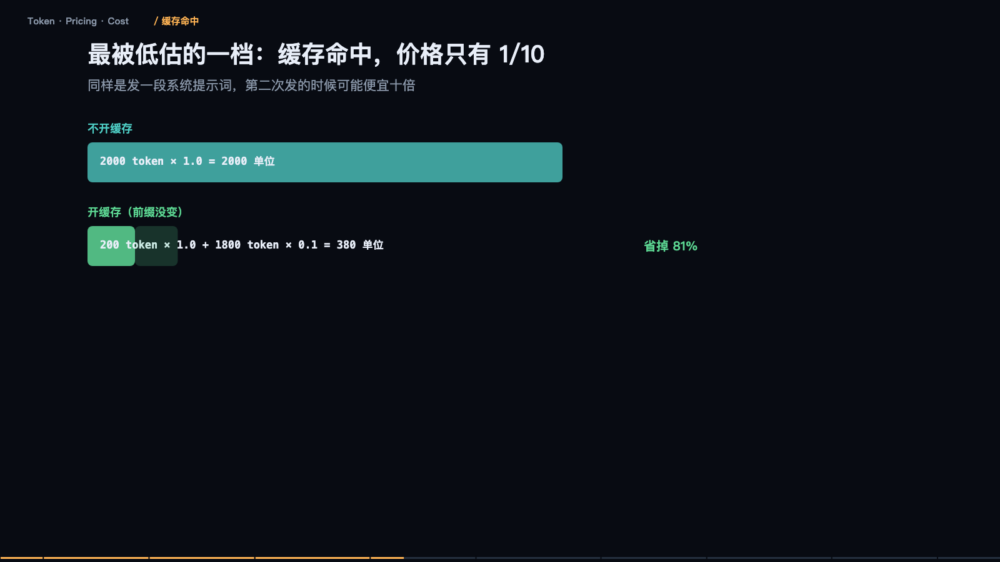

> **大模型入门系列** · 共 14 集 · 本集为第 6 集
> 上一集：[五、微调](/AI/llm101-05.html) ｜ 下一集：[七、量化与端侧推理](/AI/llm101-07.html) ｜ [系列总览](/AI/7b3f9a21.html)

<iframe src="/slide/llm-token-cost.html" style="width:100%;height:520px;border:0;border-radius:8px" loading="lazy" allowfullscreen></iframe>

账单为什么会这么高？三句话能解释八成的话费：输出比输入贵三到五倍；缓存命中能打到骨折；多轮工具调用在放大总输入。这三条都不涉及单价谈判，全是结构问题，而结构是你自己设计的。

第一个误区是 Token 不等于字数。它不是按字切，是按子词切。一句「请问这个订单什么时候发货」，大约六到九个 token，大致一个字等于一点几 token；纯英文大约四字符一个 token；而一段二十三字符的混合串可能被切成八个 token——符号和数字最费。按字数估 token，会差出一倍以上。中文、英文、代码、JSON、日志，同样长度花的钱完全不同。

准确估算法只有一个：用官方 tokenizer 实测，别用字数除以二。这一步省下的都是真金白银，因为它决定了你后面所有预算判断是否成立。

### 一张账单其实是四档不同的价

把输入价记为 1，相对关系大体如下。普通输入是你发给它的所有内容。缓存命中是前缀和上次完全一样时直接复用算过的结果，价格大约是十分之一。缓存写入是第一次建立缓存，比正常输入还贵一点。输出是它生成的每一个字，包括思考过程，价格是三到五倍。

记住这组比例就够了：输出一个字的钱，够你输入十个字。所以「限制输出长度」是最直接的省钱操作，比任何单价优化都立竿见影。

### 为什么输出贵四倍

因为它是「一个一个蹦出来的」。同样一千个 token，输入和输出的计算方式完全不同。输入是一次前向全部算完，GPU 并行吃满，效率极高，耗时大致一个单位。输出是每生成一个字都要跑一次完整前向，而且必须等上一个出来才能算下一个，一千字就是一千个单位。

所以输入是并行的，输出是串行的。贵的那部分，买的是串行的算力时间，不是 token 的「信息量」。推论很反直觉：让模型「少想一点再答」并不会省钱，因为思考 token 也按输出算价，嘴上省了，账上没省。

### 最被低估的一档：缓存命中

同样是发一段系统提示词，第二次发的时候可能便宜十倍。

算一笔：不开缓存，两千 token 乘 1.0，等于两千单位。开缓存且前缀没变，两百 token 乘 1.0 加一千八百 token 乘 0.1，等于三百八十单位。差了五倍多。

命中条件很苛刻：前缀一个字都不能变；必须放在最前面；中间不能插时间戳、随机 ID。三个常见破坏源：系统提示里写了「当前时间」；每轮都重新生成工具列表；提示词拼接顺序每次不同。修法只有一条：不变的放前面，会变的放后面。这是投入产出比最高的一次重构。

### 真正的成本黑洞：多轮工具调用

模型是无状态的，每一轮它都要把前面所有内容重新发一遍。

第 1 轮，系统提示 500 加用户 50。第 2 轮，加上次回复 80 加工具结果 200。第 3 轮，再加上次回复 80 加工具结果 300。第 4 轮，再加 80 加 250。结果四轮任务，输入成本是单次发送的 7.5 倍，而真实情况更糟：一个 Agent 任务十五到三十轮是常态，每轮都在为全部历史付费，输入 token 线性累加，总成本按三角形增长。

所以省钱的第一刀，永远砍在「塞进上下文的工具结果」。把工具返回的整个 JSON 原样塞进去，是新手最贵的习惯。只留用得上的字段——这一刀通常能砍掉三到五成输入。

### 把它算成一道公式

单次任务成本等于每轮输入 token 乘输入价之和，加上每轮输出 token 乘输出价之和。不用记单价，记住这个结构就够了。

代入一个中等规模的 Agent 任务：输入合计 6000 单位，输出合计 3200 单位，总计 9200 单位。注意分布——输出只占 token 数的百分之十二，却吃掉了百分之三十五的钱。

结论：想省大钱，改结构；想省小钱，改措辞。上线前先用 tokenizer 量一遍典型任务的 token 数，乘以单价。很多项目不是被模型能力卡住的，是被第一次月度账单卡住的。

### 六个开关，按性价比排序

提示词缓存：把系统提示固定放最前，别掺变量。限制输出：设 max_tokens，明确要求简洁、不要复述。工具结果裁剪：只回传需要的字段。模型路由：简单任务给小模型，难的才给大模型。上下文压缩：历史太长就总结，别硬塞。批处理接口：非实时的活攒起来走离线队列。至于流式输出，它不是省钱手段，只是体感手段，下一节还会再提。

优先级很简单：先动上下文，再动轮数，最后才考虑换供应商。

### 便宜模型不一定便宜

看的是「完成一件事的总成本」，不是「名义单价」。

一个小模型标价确实只有十分之一，但基础单价要乘上步数变多（三倍）、输出更啰嗦（一点五倍）、失败重试的损耗——实际总成本可能只是便宜了四分之三，而大模型两步搞定、一次就对。

所以正确做法是路由，不是全用便宜模型。让大模型反复救小模型的场，是账单上最难看的一种。还有一笔隐性成本别忘：失败任务要有人兜底，人工一分钟，比几万 token 贵得多。

> **原来如此**：成本是设计出来的，不是省出来的。上线前算一遍，比上线后砍一半容易得多。

---

> 上一集：[五、微调](/AI/llm101-05.html) ｜ 下一集：[七、量化与端侧推理](/AI/llm101-07.html) ｜ [系列总览](/AI/7b3f9a21.html)
