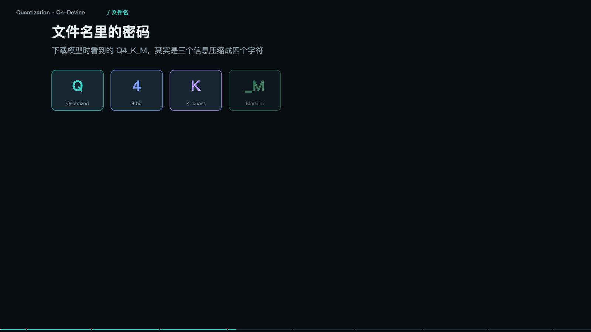

> **大模型入门系列** · 共 14 集 · 本集为第 7 集
> 上一集：[六、Token 与账单](/AI/llm101-06.html) ｜ 下一集：[八、多模态](/AI/llm101-08.html) ｜ [系列总览](/AI/7b3f9a21.html)

<iframe src="/slide/llm-quantization.html" style="width:100%;height:520px;border:0;border-radius:8px" loading="lazy" allowfullscreen></iframe>

一个几百亿参数的模型，怎么塞进一台手机？三件事合起来：把每个数字压窄、少读内存所以快、最后装进设备。这三件事合起来叫量化（Quantization）。

先算一笔账，公式只有一条：模型大小等于参数个数乘每个参数占几个字节。FP32 是四字节，每个数三十二位，最精确也最占地方；FP16 是两字节，半精度，训练后的默认体重；INT8 是一字节，只用两百五十六个整数档位；INT4 是零点五字节，只剩十六个档位，手机上跑得动。

代进 7B 模型：FP16 大约十四 GB，INT8 大约七 GB，INT4 大约三点五 GB。而手机可用内存大约四 GB，笔记本十六 GB。结论立刻清楚：要上手机，必须走到 4bit。

> **原来如此**：量化不改架构、不加参数，只是把每个数的写法从 32 位砍到 4 位——同一张成绩单换个写法。

### 量化到底动了什么

把一把刻度极细的尺子，换成一把刻度很粗的尺子。连续值想多细就多细；FP16 有六万五千多档；INT4 只剩十六档。

刻度少了，相邻两个数会被压成同一个格子，这就是精度损失。做法是引入一个缩放因子：scale 等于最大值减最小值，除以二的位数次方减一。所有数先除以这个 scale，四舍五入成整数存起来，用时再乘回去。一个缩放因子，决定整组数的精度。

所以量化的核心问题从来不是「要不要量化」，而是「怎么分组」。这句话是整节的重点。

### 直接一刀切会出事：离群值

一组数里只要有一个离群值，其他全被它连累。

场景是这样：一整层权重大概率都在正负一之间，但有一个值是 15.8。如果整层共用一把尺子，缩放因子被拉到 0.124，其余三十一个数本来有两百五十六分之一的分辨率，现在只剩正负八个整数格——精度全毁，模型行为直接崩。

做法 A 是整层共用一把尺子，也就是上面这个悲剧。做法 B 是分组量化：每三十二个数一组，各用各的尺子。含离群值的那组保留 FP16，其余组正常量化，精度得以保住。

由此形成「三件套」：分组更细（三十二甚至十六个一组）；离群值单独留高精度；重要性高的层用更高位宽。这就是 Q4_K_M 里那两个字母的含义。

量化做得好不好，看的不是平均值，而是最差的那一组能到什么程度。所以工程上很少用整层量化，都是分组加混合精度。

### 文件名里的密码

下载模型时看到的 Q4_K_M，是三个信息压成四个字符。Q 表示量化过的，4 表示每个数四位，K 表示分组式量化，M 表示中等混合精度，即关键层混更高精度。

同样是 7B，不同量化的体积差别很大：Q2 系列压得最狠但损失明显，Q4 大约三点五到四 GB，Q8 接近七 GB。Q4 是社区公认的甜点——体积约三分之一，效果损失很小。这也解释了为什么本地部署的默认推荐永远是 Q4_K_M 而不是更小的 Q2。

至于怎么跑起来：GGUF 就是一个「打包格式」，把权重、元数据、分词器打成一个包，谁都能读。端侧生态能起来，靠的就是这个格式统一——手机 App、桌面端、嵌入式，同一个文件到处能跑。

### 速度：够用就行

衡量体验只有一个指标：每秒吐几个字。云端 70B 级能力最强，但要联网、要付 token 费。笔记本上的 7B Q4，M 系列芯片或独显，日常够用、离线可用，速度大致在每秒十几到几十个 token。手机上的 3B 到 4B 走 NPU，大约刚好赶上人的阅读速度，低端机跑更小的模型反而快，但脑子简单。

人类阅读大约每秒八个字，超过八到十个 token 每秒，人就不觉得卡了。所以端侧小模型的速度焦虑，大半是心理焦虑——真正让人不满的不是速度，是答得不对。

### 量化还买了一张门票：硬件加速

手机里真正干活的不是 CPU。CPU 什么都能算，但慢、费电；GPU 并行算力强，快但很费电；NPU 专为神经网络设计，最快最省电，但它只认整数。

所以模型必须被量化成整数，才能被 NPU 接住。这就是量化的第二个好处，常被忽略，但它才是端侧体验的分水岭：省内存让你装得下，能上 NPU 让速度和功耗直接降一个数量级。各家手机的加速入口不同，高通有 QNN、华为有 CANN、苹果有 Core ML，但共同前提都是整数化。

### 内存墙：账还没算完

权重只是入场费，运行时还要租两间房。

第一间是模型权重，7B 乘 4bit，约三点五 GB，固定不变，跟着模型走。第二间是 KV cache，上下文 4K 时的对话记忆，随上下文长度线性增长——聊得越久越吃内存。第三间是运行时开销，中间结果加框架自身，也要占一份。

三者加起来就是内存墙。虚线是手机可用内存上限约四 GB。所以手机上跑 7B 要么缩上下文，要么继续降到 3B。标称四 GB 的模型，真正跑起来通常要六 GB 以上。决定端侧能不能跑的，不是「模型多大」，是三者加起来多大。

### 端侧还是云：五个约束的权衡

这不是技术偏好问题。端侧赢在：数据不出设备、飞机上也能用、没有网络往返、不按 token 付费。云赢在：大模型才够聪明、数据要上传、断网即失效、一段网络往返、每千 token 计费、最大最强。

实际产品的答案是混合：端侧小模型先接住敏感信息、简单任务、离线场景；加一个路由判断；不确定或需要推理的再上云；云端兜底复杂任务和需要最新知识的请求。端侧不是云的替代品，是云的前置过滤器——九成的简单请求在设备上就消化掉了。

量化不是「廉价版模型」，它是让模型离开机房、走进日常设备的那一步。体积、精度、速度三者之间那条线，就是工程经验。

---

> 上一集：[六、Token 与账单](/AI/llm101-06.html) ｜ 下一集：[八、多模态](/AI/llm101-08.html) ｜ [系列总览](/AI/7b3f9a21.html)
