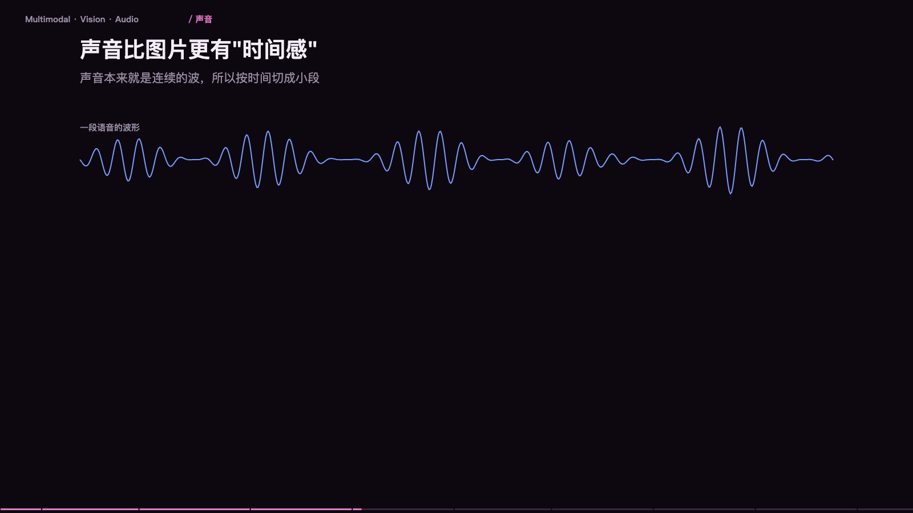

> **大模型入门系列** · 共 14 集 · 本集为第 8 集
> 上一集：[七、量化与端侧推理](/AI/llm101-07.html) ｜ 下一集：[九、检索](/AI/llm101-09.html) ｜ [系列总览](/AI/7b3f9a21.html)

<iframe src="/slide/llm-multimodal.html" style="width:100%;height:520px;border:0;border-radius:8px" loading="lazy" allowfullscreen></iframe>

先说一个容易被忽略的事实：模型的整个世界，从头到尾只有一串数字。它没有「看见」这个动作，它只认数字。所以「让模型看图」这件事，本质是把图翻译成一串数字，塞进同一个队列，和文字排在一起。

两条路最后都汇进同一个数字序列：文字走分词器变成 token，图片走视觉编码器变成 patch 向量，之后没有区别——对后面的八十层来说，一个图片 patch 和一个词就是同一类东西，只不过一个词代表一片语义，一个 patch 代表一片颜色。

> **原来如此**：所谓多模态，不是给模型装眼睛，是给图片造一套翻译。翻译做得好不好，决定了它「看」得准不准——后面所有缺陷都源于这一步。

### 一张图变成 token 的全过程

三步，没有魔法。第一步切成小块（patch），通常十四或十六像素见方。第二步用视觉编码器把每块变成一串数字，也就是一个向量。第三步拼进上下文，图片和文字最后躺在同一个列表里。

一张 1024 见方的图，按 16 像素切，就是 64 乘 64 共 4096 个 patch。这个数字直接决定了成本，也直接决定了后面要讲的取舍：块切得越细，看得越清，token 也越多。

### 一张图算多少钱

换算式很简单：token 数约等于宽除以块边，乘上高除以块边。缩略图级别可能只有几十个 token；普通配图几百；截图和文档几百到一千多；高清大图上千。

换算成生活单位更好理解：一页 A4 文字大约几百 token；一张 1024 截图约等于五页文字；一张 2048 原图约等于二十页文字。所以传二十张高清图，等于把四十页文档塞进上下文——贵，而且会挤掉别的信息。

省钱的土办法：传图前先缩到必要尺寸、裁掉无关区域。但有个反向的例外——文档截图反而要给足分辨率，图里的字一旦糊了，模型就永远读不对，这时候省下的 token 会以「答错重试」的形式加倍还回去。

### 声音比图片更「贵」：25 毫秒一帧

声音本来就是连续的波，所以按时间切成小段：每二十五毫秒切一帧，每一帧转成一张频谱图，再变成一个向量。一秒钟四十帧，一分钟两千四百帧。

对比一下：一分钟文字大约两百字，折算几百 token；一分钟语音十六 kHz，两千四百帧，折算下来是数量级的差距。语音贵在帧率——说一句话的时间，模型要处理几百个「图」。这就是语音对话按分钟收费、而不是按字数收费的根本原因。

### 视频是图片的平方

它不是「很多张图加起来」，而是直接指数爆炸。两秒视频按三十帧每秒是六十帧，每帧上千 token，合计几万 token，相当于二十页文档，只换来两秒画面。

所以视频理解必须做减法，四个手段：降帧率，三十帧抽到一到两帧；降分辨率，短边压到三百三十六；时间合并，相邻帧融合成一帧；只看关键段，先定位再细看。

视频理解的本质不是「模型够不够大」，而是「抽帧策略对不对」——这一条比换模型重要得多。

### 输出侧：同一句话可以被生成成图、成声、成视频

语义空间里，文字、图片、音频都编码成同一套向量表示。编码器把图变成向量，把频谱编码成向量；反过来，解码器能从噪声逐步去噪成图，或者把文字转成声波。生成图片不是「画」出来的，是从噪声里「擦」出来的——这条链路在第十四节会完整拆开。

### 四个高频翻车现场

根子全在「翻译」那一步。小字看不清：图里八磅的合同条款、表格里的小数点，被压缩后直接糊成一团，模型只能猜。数量数不准：让它数图上有几个苹果、几根柱子，这是它最不擅长的题，精度常低于随手一数。空间关系弱：「左边那个」「上面的按钮」这类指代，它经常对错。压缩失真：聊天软件转发过的图、截图再截图，细节已经丢了，模型看到的是二次污染版本。

工程解法三条：关键区域单独裁一张高清图再问；要精确数字就让它输出坐标或用 OCR 工具；别用它做计数和精确测量。它不是眼睛，是「隔着毛玻璃看」——把任务设计成它擅长的形状，比换更大的模型有效。

### 什么时候用通用多模态，什么时候用专用模型

通用模型胜在「能解释」，专用模型胜在「够精确」。

识别图里的文字：通用能读，但排版和小字易错；OCR 逐字精确。语音转文字：通用省事，长音频要分段；ASR 专用更稳更便宜。水果、缺陷、计数：通用容易数错；目标检测和分割模型更可靠。理解场景和意图：通用是强项，能解释；专用做不了。跨模态推理：通用强项，图和文字一起推因果。

实践里最常见的组合是分层：专用模型负责「取」——OCR 取字、ASR 取话、检测框取位置；通用模型负责「串」——把取出来的东西串起来，回答人真正想问的问题。别指望一个模型包打天下，精确的活交给小专模型，理解的活交给大通用模型。

> **原来如此**：模型从来不「看」，它只读数字。图片、声音、视频全都被翻译成同一种数字，翻译的精度，就是它「看」的上限。

---

> 上一集：[七、量化与端侧推理](/AI/llm101-07.html) ｜ 下一集：[九、检索](/AI/llm101-09.html) ｜ [系列总览](/AI/7b3f9a21.html)
