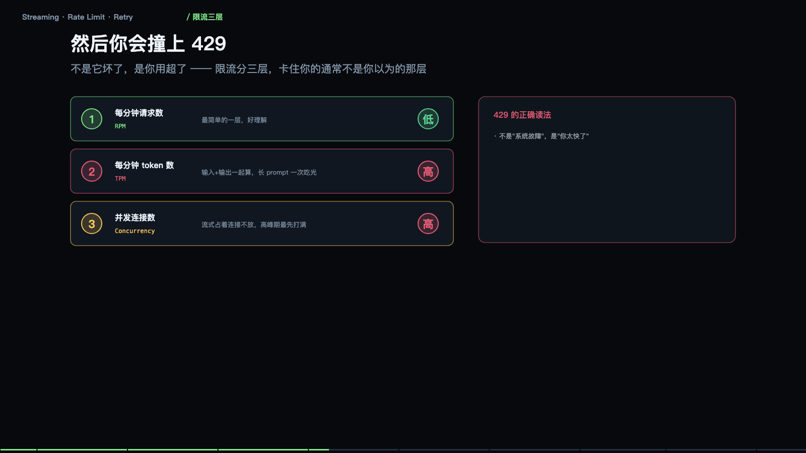

> **大模型入门系列** · 共 14 集 · 本集为第 11 集
> 上一集：[十、把话说明白](/AI/llm101-10.html) ｜ 下一集：[十二、记忆](/AI/llm101-12.html) ｜ [系列总览](/AI/7b3f9a21.html)

<iframe src="/slide/llm-stream-ops.html" style="width:100%;height:520px;border:0;border-radius:8px" loading="lazy" allowfullscreen></iframe>

本地跑通只是及格，接进产品才刚开始。这一节讲的全是「不处理就不能上线」的问题，四个：流式、限流、重试、超时降级。

先说最影响体感的一件事：同样的答案，一起给和慢慢给，用户感受差十倍。等全部算完再给，四十秒里屏幕一直是空的，用户在第 8 秒就以为卡死了，直接关掉。算一点给一点，0.5 秒出第一个字，四十秒出完，阅读和生成同时进行，等待感消失。

两个必须盯的数字。首字延迟 TTFT：从发请求到看见第一个字，用户对这个极度敏感，要压到 1 秒内。总时长：只要在动就没人在意，所以流式是改善体感最便宜的手段。

> **原来如此**：用户抱怨「慢」，抱怨的其实不是总时长，是那几秒什么都没发生。流式不改变实际速度，只是把等待摊薄了。

### 它是怎么「流」出来的

服务端算出一个就推一个，浏览器边收边拼，用的是一条不断开的长连接，也就是 SSE。前端收到的每一行都是一个增量，不是全文——这一点是所有 bug 的源头。

要接在「已显示的文本」后面，而不是替换。网络会把包切碎，一个 chunk 可能只有半行 JSON，要按换行符缓冲，攒够一行再解析。流式还有流式自己的错法：中途 429、内容审核、长度超限，都会在流里出现。

一个常见 bug：把每次收到的内容当成完整答案刷新显示，结果屏幕上只剩最后几个字，前面全被覆盖了。它不是「重复发送」，而是「增量」——所以永远拼不回原句，除非你按顺序累积。

### 流式带来的四个新问题

这是拿工程复杂度换体感，下面四个问题只在流式下才会遇到。

其一，中断无从续：已经吐了三百字，连接断了，重试要从头再发一遍，前三百字的钱已经花了。解法是按段落做检查点，重连时把已生成部分作为前缀再续。其二，半截结构没法用：流到一半的 JSON 是非法 JSON，直接 parse 会崩。解法是只在收到结束标记后解析，或者边收边做容错解析。其三，半截 Markdown 渲染错：只收到三反引号而没有闭合，渲染器会把后面全刷成代码块。解法是按块渲染，未闭合的代码块先当纯文本。其四，错误藏在流里：HTTP 已经 200 了，错误在 data 里以 error 事件返回。别只看状态码，要检查流内的 error 类型。

流式把「一次请求」变成了「一条长连接」，长连接会断、会超时、会中途出错，这才是真正的工程量。

### 429 与三层限流

然后你会撞上 429。它不是服务坏了，是你用超了。限流分三层，卡住你的通常不是你以为的那层：RPM 每分钟请求数，最好理解；TPM 每分钟 token 数，输入输出一起算，长 prompt 一次吃光；并发连接数，流式占着连接不放，高峰期最先打满。

429 的正确读法是「你太快了」，不是「系统故障」。看 retry-after 响应头，它会告诉你几秒后再试。别立刻重试，那只会继续 429，并且把配额耗得更干净。

为什么 TPM 最容易被忽略：一个八万字文档问答等于十二万 token，配额十万每分钟，一次请求就超了。所以长文档任务要排队加切片，而不是并发猛冲。

> **原来如此**：限流不是障碍，是合同条款——它按 token 卖，你就得按 token 规划。先算清一次请求要吃多少 token，再决定能并发几个。

### 重试的纪律：做错比不做更糟

该重的不重，用户干等；不该重的重了，账单翻倍。

可以重试的：429 限流、连接超时、读超时、连接被重置。不能重试的：400 参数写错了、401 或 403 权限、内容审核拒绝、上下文超长。后四类重试一万次也一样，只会浪费时间和钱。

重试间隔用指数退避加抖动：每次都翻倍，再加一点随机偏移，防止所有客户端在同一秒一起重试，形成新的尖峰。

重试前必须解决的前提是幂等：请求里带一个唯一的 request_id，服务端见到同一个 id 直接返回上次结果。否则重试等于重复生成，等于重复扣费。流式场景更麻烦，前面已经吐出去的字没法撤回。

> **原来如此**：重试不是「再试一次」，是「在确认安全的前提下再试一次」。幂等、退避、分类，三个缺一个，重试就从保险变成了风险。

### 超时要拆两段，降级分三档

还有一类问题：它没报错，就是不给结果。所以超时不能只有一个数。

一条请求的时间轴有三段：发请求、首字到达、生成结束。对应两个阈值：首字超时 15 秒，总超时 120 秒。为什么要拆：卡在首字之前，大概率是排队、限流或服务过载，该做的是切节点或降级，不是继续等；首字之后的慢，是模型在正常生成，只是长，该做的是提示用户「还在写」，别掐断。

降级三个档次：换小的（大模型超时，小模型先答，够用就行）；先给旧的（有缓存或历史答案，先顶上，后台再算新的）；老实说（都不行就明确告诉用户稍后重试，别转圈）。用户能接受「差一点」，不能接受「没反应」。

### 两个关于成本的错觉

错觉一：流式能省钱。不省。按 token 计价，流不流式一个价。流式只改善体感，它甚至因为长连接占用，让并发成本更高。

错觉二：用户关了就不花钱。不一定。请求已经被处理，token 就已经消耗了。除非你在前端断开时同步发取消请求，否则服务端照样算完、照样计费。

真正能省钱的地方还是那四件：砍输入（同样的问题，prompt 少两千字，长期省得最多）；用缓存（固定前缀命中缓存，价格差好几倍）；选对档位（简单任务用便宜模型）；限输出（max_tokens 卡住上限，防跑飞的回答）。省钱从来不在「流不流」，而在「让谁去答」。

### 上线之后，四个数字决定生死

首字延迟 P95、输出速度、429 占比、重试成功率。这四个数掉下来，用户就会走，而它们不会自己报警。

模型服务不会告诉你「今天变慢了」，它只是安静地慢下去。所以必须自己埋点，看趋势而不是看单点：把首字延迟画成一周的曲线，往往能看到「这里开始变慢，但没有任何报错」——那就是上游发版了。

大模型应用最典型的故障不是「崩了」，是「慢慢变差」。埋四个点，比写四千行代码有用。

本地跑通，只证明了它「能用」；流式、限流、超时、监控，才决定它「能上线」。

---

> 上一集：[十、把话说明白](/AI/llm101-10.html) ｜ 下一集：[十二、记忆](/AI/llm101-12.html) ｜ [系列总览](/AI/7b3f9a21.html)
