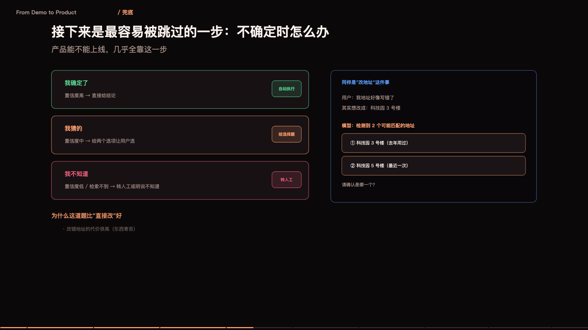

> **大模型入门系列** · 共 14 集 · 本集为第 13 集
> 上一集：[十二、记忆](/AI/llm101-12.html) ｜ 下一集：[十四、从提示词到像素](/AI/llm101-14.html) ｜ [系列总览](/AI/7b3f9a21.html)

<iframe src="/slide/llm-to-product.html" style="width:100%;height:520px;border:0;border-radius:8px" loading="lazy" allowfullscreen></iframe>

会调 API 的人很多，能把模型接进业务流程、让它稳定创造价值的人很少。这两件事之间隔的不是技术，是产品判断。

判断标准可以压成三个圈的交集。第一个圈是「模型擅长的」：语言理解、生成、抽取、归类、改写，这些是它的强项。第二个圈是「业务需要的」：有明确输入、有可验收输出、有人愿意为结果付费。第三个圈是「必须现在做的」：不是「有了更好」，而是不做就疼。

三个圈的交集才是值得做的项目。落在圈外的东西，无论演示多惊艳，最后都会变成没人用的功能。这一句话能挡掉大部分「我们要不要做个 AI」的讨论——因为大部分候选连第一个圈都不在。

> **原来如此**：模型能力决定下限，场景选择决定上限。选错场景，再强的模型也只是玩具。

### 用一句话能不能说清

一个需求如果不能用一句话说清「谁、在什么场景、把什么变成什么」，它就不该进入开发。

例子：客服组长每天早上要花两小时看昨天的会话记录，找出投诉苗头——这句话里，谁（客服组长）、场景（每天早上）、输入（会话记录）、输出（投诉苗头清单）全都清楚。这种需求可以直接开工。

反例：「我们要用 AI 提升效率」。它什么都说，也什么都没说。方向不是需求，需求必须有边界。

还有一层更实用的检验：这件事如果交给一个实习生做，他能做吗？如果连实习生都需要培训三个月，那大概率也不适合交给模型——因为模型的判断力大致相当于一个聪明但没有行业经验的新人。反过来说，那些「实习生能做但很费时间」的活，才是模型的最佳落点。

### 完成度分三档，别一上来就想做完美

六七十分：能用，但需要人在旁边盯着。比如自动整理会议纪要，错字和语气要人工修一遍。这一档的价值是「减少重复劳动」，可以立刻上线，前提是明确告诉用户「这是草稿」。

八九十分：基本可交付，抽检即可。比如把客户邮件归类并生成回复草稿，人工只做审核和个别修改。这一档的价值是「提效」，要求的是一次通过率足够高。

九十五分以上：可以无人值守。比如发票信息抽取，字段固定、格式固定、能自动核对总额。这一档的价值是「省人」。

绝大多数项目应该停在第一档，因为它能最快产生价值，并且暴露真实问题。执着于一次做到九十五分，最常见的结果是永远上不了线——而真实的问题（用户到底怎么用、错误出现在哪里）只有上线才知道。先跑通、再提高，这个顺序在 AI 项目里比在传统软件里更重要，因为模型的行为只有在真实数据上才会暴露。

### 三个上手方向，按回报排序

内部效率工具：会议纪要、文档初稿、数据整理、邮件回复。特点是用户就是同事，容错高、反馈快、见效快，是最好的第一站。

业务流程嵌入：工单分类、合同审查、简历初筛、客服辅助。特点是需要和现有系统对接，收益明确但周期长，要先解决接口、权限、审计三件事。

面向用户的产品功能：智能问答、写作助手、个性化推荐。特点是用户挑剔、错误代价高、需要处理长尾，通常应该放在第三顺位，因为前面两个阶段积累的评测集和护栏，正好是它的地基。

顺序别搞反。上来就做面向 C 端用户的功能，是把最难的一档放在第一天做。

### 数据飞轮与度量

上线不是终点。真实使用会产生数据：用户问了什么、模型答了什么、用户改了什么、用户放弃了什么。这四类数据是最珍贵的资产，因为它们直接告诉你模型错在哪。

闭环是这样：埋点采集 → 抽样标注 → 进评测集 → 改提示词或检索 → 回归测试 → 上线。每一轮都把「真实错误」变成「测试用例」，于是系统只会越来越稳。

度量上，别只看准确率。业务方关心的是：处理量、人工介入率、平均处理时长、用户满意度。技术指标（首字延迟、失败率、每单成本）只用来解释业务指标为什么变。一个模型准确率从 88% 提升到 91%，但如果人工介入率没变，业务方不会觉得有任何改善。

最后一条，也是最容易被忽略的：留一个人工兜底的出口。任何自动流程都要有「转人工」，且要有明确的触发条件——置信度低、涉及金额大、用户情绪激烈。这不是能力不足的妥协，而是产品的必要条件：用户知道随时有人接得住，才敢把事交给它。

十三集讲完，回到最初那个问题。它本质上只是一台「猜下一个字」的机器：注意力机制让它能看见上下文里的关联，三层结构让它能表达复杂模式，训练让它从数据里学到语言和知识。但真正让它有用的，从来不是这些机制本身，而是围绕它建起来的一整套工程：怎么给上下文、怎么给工具、怎么给证据、怎么兜住错误、怎么衡量好坏。模型会继续换代，这套工程不会。

以上十二到十六件事，如果你只能记住一句：把它当成一个聪明、勤奋、但完全不了解你的新同事。你需要做的不是找到一个神奇的句子，而是把背景、目标、约束、验收标准，一件件交代清楚。

---

> 上一集：[十二、记忆](/AI/llm101-12.html) ｜ 下一集：[十四、从提示词到像素](/AI/llm101-14.html) ｜ [系列总览](/AI/7b3f9a21.html)
