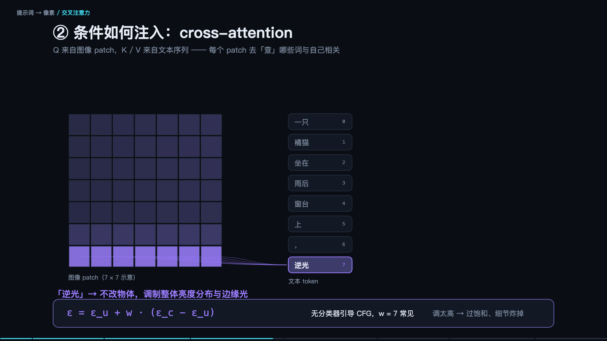

> **大模型入门系列** · 共 14 集 · 本集为第 14 集
> 上一集：[十三、从能跑到好用](/AI/llm101-13.html) ｜ [系列总览](/AI/7b3f9a21.html)

<iframe src="/slide/prompt-to-pixels.html" style="width:100%;height:520px;border:0;border-radius:8px" loading="lazy" allowfullscreen></iframe>

最后一集换个视角：前面讲的模型都在「读」，这一集讲它怎么「画」。

先把最反直觉的一点说清楚：模型从来没有「画」过任何东西，它只是在一张全是噪声的画布上，一点一点地把噪声擦掉，直到剩下可被识别的图。所谓生成图片，本质是「去噪」。

文字的模态不同，但链路是同一条：文字被编码成语义向量，图也从像素被编码成语义向量，两边在同一套坐标系里对口。文字这边走的还是第十三节那套注意力；图片那边走的是扩散。两者必须对齐。三次关键对齐发生在训练里：文字编码器和图片编码器的语义要对上；生成器要能听懂「语义坐标在说什么」；解码器要把坐标还原成像素。

> **原来如此**：模型不是在「画图」，是在「擦掉噪声」，每一步只擦一点点。

### 差距不在提示词，在评价系统

很多人以为画得不好是提示词写得不够。真正的差别在评价：你说「好看一点」，人知道什么叫好看，机器不知道——它没有那个尺子。

两种不同的难。写提示词是「描述不准」，多写几次总能逼近；评价图片是「说不清」，你说不出哪一笔不对、为什么不对。前者可以靠迭代，后者必须靠外部信号。

所以同一套模型、同一个提示词，有设计功底的人和没有的人产出差很多——差距不在提示词技巧，在于他知道「哪里不对」，也知道「该往哪个方向改」。

### 扩散模型：蹲在数据分布上撒点

看图。左侧深色区域代表「所有真实照片在语义空间里的分布」，也就是数据分布；每个点是一张图。「一只狗」的照片集中在这一片，「一只猫」在另一片，「一个人」在另一片。它们不是散乱的，而是有形状的。

左下角的红点是一张纯噪声。训练要解决的问题是：给定一个乱点，模型要一步步把它推向真实分布里的某个位置。训练的过程就是「把噪声一点一点加进去」——先给一张真图，加一小点噪声，教模型「如何去掉这一点噪声」；再加一点，再教；重复一千次，图彻底变成噪声。每一步的「加噪后」和「加噪前」都成为一对训练样本。这就是前向过程。

关键的反向过程：模型学的是每一步的「去噪方向」，也就是从噪声里指出哪里有噪声。推理时，从纯噪声出发，让它预测噪声、减去一点、再预测、再减，重复几十步。每一步只去掉一点点，最后剩下的就是它「认为」的图。

> **原来如此**：训练学的是「噪声长什么样」，推理做的是「把噪声一点点擦掉」——方向反了，但用的是同一套参数。

### 为什么结构先出来，细节后出来

因为它是在「从粗到细」地减噪。最初的几十步，只擦掉大块噪声，画面上先出现轮廓和色彩分布——你会看到一团模糊的形状先成形。后面的步，噪点越来越小，才开始补纹理、修边缘、画五官。所以生成过程通常是：第 1 步纯噪声，第 5 步出现色块，第 10 步结构成立，第 20 步细节显现，第 30 步收边，第 50 步完成。

这也解释了两个常见经验。第一，构图靠提示词里的大词（主体、场景、视角），因为前期决定结构。第二，风格和质感靠后面的细化，所以「油画感」「胶片颗粒」这类词影响的是后半程。

### 文字到底怎么「推」这张图

靠一个很小的技巧，叫 CFG（无分类器引导）。做法是算两次：一次带着你的提示词，一次不带（空提示词），然后取两者的差，再放大。

具体算式：结果等于空提示词的结果，加上一个系数 k 乘以两者之差。k 为零，完全不理会提示词，图会随机；k 很大（比如二十），全力扑向提示词，画面会过度锐利、僵硬、颜色过饱和。

所以调 k 就是在「听不听话」和「自不自然」之间找平衡。一般七到十二之间，太听话反而假。这是在横轴上「平衡感官和模式识别」的一个具体工程手段。

实践上还有一个用法：负面提示词，其实就是把「不想要的东西」放进「空提示词」的位置，于是减去的方向变成了远离它。这是同一套机制。

### 文生图搞不定的三件事

三个翻车现场，每个都能在生成的过程里找到原因，也各有解药。

构图不可控：要「人在左、狗在右」，它经常左右颠倒。原因是扩散过程从头到尾都没有「位置」这个概念，提示词只是一堆词，不是布局图。解药是从「用语言描述位置」换成「给结构图」：深度图、边缘图、姿态骨架（ControlNet 这一类）——把结构直接喂进去，别指望文字管住空间。

细节不可数：「三只猫」大概率给你四只或两只，手指数目更是常年错。原因是它学的是「像猫的视觉模式」，不是「数数」这件事。解药是宁可多次生成再挑，别指望一句话管住精确数量。

文字与品牌：图里的文字经常是错的、乱码的。因为字在视觉上是纹理，不是符号。解药是图标部分用工具生成，文字部分用排版工具后期叠——这条在电商与海报场景几乎是标准流程。

### 可控生成：把「随便画」变成「按图纸画」

四种控制方式，本质都是「在去噪过程里加约束」。

一是结构约束：给深度图、边缘图、姿态骨架，让它按骨架填肉。二是区域约束：用遮罩限定「这块区域画什么」，其余不动。三是参考约束：给一张参考图，提炼它的风格或人物身份再迁移。四是迭代修正：先在低分辨率上确定构图，再用小幅度修改（图生图）逐步改，而不是一次到位。

一个实用参数是去噪强度：太低改不动，太高会推翻原图。它决定「改多少」，是修图类工作最重要的旋钮。

### 从「做出来」到「修得好」

生成一张能用的图，主要靠修，不靠一次成功。

标准流程大致是：先在低分辨率快速出四到八张，选构图方向对的；放大到高分辨率，再修细节；局部重绘（只改手、脸、背景）；最后做后处理（色彩、锐化、叠字）。每一步都用前面那张图作为输入，而不是重新描述一遍——因为在下一轮，模型看到的是图，不是文字。

> **原来如此**：文字给方向，图给约束。

### 工程上，它和文字模型用什么不同

评价方式不同：文字有对错，看图没有标准答案，所以必须靠人筛或靠另一个模型打分。这一点决定了图片产品的交互形态——它是「生成很多张，让人挑」，而不是「给一个答案」。

成本结构不同：单张图的计算量比一次文字请求大得多，所以按张收费，而且分辨率直接决定成本。可控性不同：文字的种子（seed）固定就能复现，图片也大致可以，但换一个版本或换一个采样器，结果就不可复现——所以产品里要保存「种子加参数加模型版本」这组三元组，否则你没法重做一张图。

最后一件事，也是这两类模型最本质的相似之处：它们都不理解你说的话，只对齐统计规律。文字模型对齐的是「下一个字」，画图模型对齐的是「下一步噪声」。你要的结果，永远来自你对齐得多准，而不是你说了什么。

十四集到这里。如果只能记一句：这些模型的共同点，是它们都在做「从上下文猜下一块」——文字猜下一个 token，图片猜下一步噪声。理解这一点，你就知道该往哪里放信息、该在哪里设护栏、该在什么时候承认它做不到。

---

> 上一集：[十三、从能跑到好用](/AI/llm101-13.html) ｜ [系列总览](/AI/7b3f9a21.html)
